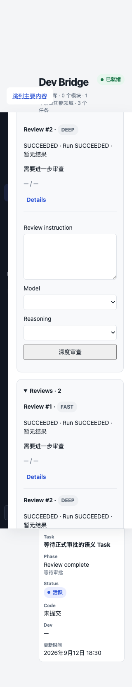
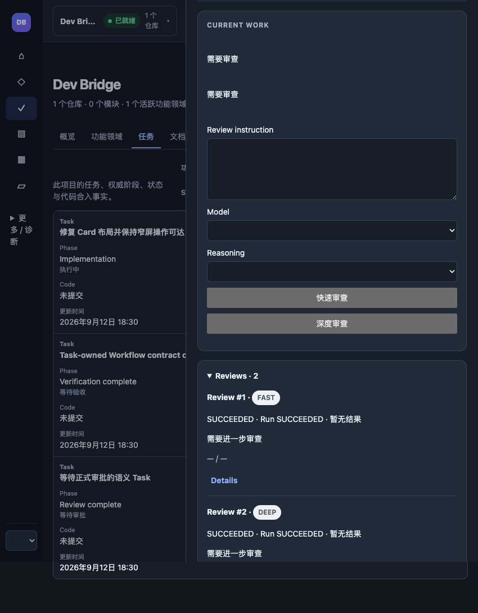

# REVIEW_FAST_DEEP_ARCHITECTURE_CLOSURE 交付报告

> 历史验收记录：以下结论仅对应报告当时的版本、环境和范围，不代表当前工作区已重新验收。参见[历史验收索引](../README.md)。 本报告整理前的原文及同期证据保存在[批次归档](../archive/review-fast-deep.md)中。

已实施并通过下列验证，保留未提交工作区供人工审查。

1. **Starting branch / HEAD**：`dev_20260908_1913` / `6f739fa02a9d0b209a63eb2bb111d9fb00186886`。开始时 working tree clean；最终 branch / HEAD 相同。
2. **Schema**：v45。新增 canonical `schema_v45.sql` 与显式 v44→v45 migration；历史 v44 schema 未改。
3. **ReviewDepth**：canonical `task.ReviewDepth`，`review.ReviewDepth` 为类型别名；仅 `FAST | DEEP`。Review 必须显式提供，持久化且不可修改；不解析 ordinal、prompt 或 effort。
4. **required_review_depth**：durable minimum，`FAST < DEEP`。新 Task=FAST；admission 成功后等于请求 depth；APPROVAL_READY/APPROVE/REJECT/terminal 清空；FURTHER=DEEP；REVISE=FAST。不是新 phase。
5. **FAST progression**：可以直接 APPROVAL_READY→REVIEW_APPROVAL_PENDING，也可以 FURTHER_REVIEW_REQUIRED→REVIEW_REQUIRED+DEEP；后者无 Decision，不自动创建下一个 Review/Run。
6. **DEEP progression**：可以进入审批，也可以继续要求 DEEP；允许任意多个独立 Review attempt。
7. **reviewDisposition**：structured result 必填 enum `APPROVAL_READY | FURTHER_REVIEW_REQUIRED`。APPROVAL_READY 验证完整 implementation proposal；FURTHER 可以携带 null work/verification。只从成功 Run 的合法结构化结果持久化 disposition，拒绝从 summary 推断。
8. **Review 1:1 Run**：保持 `Task → Review [0:N] → Run [1:1]`；新深度只创建新的 Review attempt。现有 Execution [0:N] 未改变。
9. **Latest-only Approval**：current_review_id、Task ACTIVE/REVIEW_APPROVAL_PENDING、Review APPROVAL_READY、exact successful Run/result/provenance 共同 fencing。历史或 FURTHER Review 不可审批，返回 STALE_REVIEW_APPROVAL。审批不会创建 Task。
10. **Infra/recovery**：没有 disposition/Approval，Task ACTIVE 且保留当前 depth floor；DEEP 失败后不能降为 FAST。UNKNOWN/UNKNOWN_ORPHANED、epoch、claims、late callback、recovery 和生产 finalization 逻辑未改。
11. **task_review_start API**：必填 reviewDepth，与 model、reasoningEffort、reviewPlan、reviewInstruction 独立。低于 floor 返回 REVIEW_DEPTH_TOO_SHALLOW，包含 requestedDepth、requiredReviewDepth、taskId、phase；Review/Run/claim/成功 receipt 零写入。depth 纳入 requestId payload hash；同请求重放不重复 dispatch，改 depth 为 payload conflict。
12. **Migration/backfill**：所有历史 Review=DEEP；只有已有正式 Decision 的 Review 回填 APPROVAL_READY，原始 result、prompt、hash、phase、pointers、counts 不变。安全 REVIEW_REQUIRED→FAST；终态失败后的 REVIEWING→DEEP；审批/implementation/terminal→NULL。旧 in-flight、UNKNOWN、UNKNOWN_ORPHANED、未完成成功 transition 等歧义状态 fail closed，回滚保留 v44 数据并明确 rebuild 指引。不会自动创建 operation/Approval 或推进 phase。
13. **Prompt byte identity**：FAST/DEEP 分别验证 leading/trailing whitespace、CRLF/newlines、Unicode、symbols、长指令；stored Review instruction、persisted final prompt、实际 fake backend prompt、SHA-256 和 UTF-8 byte count 一致。见 [prompt-byte-identity.log](../archive/review-fast-deep.md#file-2e55c0d11af68b02)。生产 prompt builders/transport 未改。
14. **四维正交**：32 组 depth×FOCUSED/REPOSITORY×low/medium/high/xhigh regression 通过，模型和指令保持原值；包括 FAST+xhigh、FAST+REPOSITORY、DEEP+medium、DEEP+FOCUSED。depth 不改变 repository/workspace/Git/network/runtime/read-only authorization。
15. **WebUI**：初始 FAST+DEEP；DEEP floor 只显示深度审查；显示 FAST/DEEP badge；FURTHER 显示需要深度审查/进一步审查且保留 SUCCEEDED；APPROVAL_READY 等待审批。仍选择语义 Task，instruction 只在 Review detail/history，历史无审批动作。窄屏和 light/dark 已测。
16. **Card / Console / JSON**：shared TaskView、workflow guidance、MCP current/review/detail、Console Task/Review summaries 均提供相同 depth/disposition facts。allowedReviewDepths 由唯一 shared helper 派生；Card next step 仅列合法深度。无客户端 progression reducer。
17. **Modified files**：完整清单见 [modified-files.txt](../archive/review-fast-deep.md#file-73555caab7c1ffb3)，最终状态见 [git-status.txt](../archive/review-fast-deep.md#file-92e345b4358b0a4e)。生产更改集中于 Task/Review 类型、SQLite admission/progression/schema、API/schema、shared presentation 和既有 UI；其余主要是显式 fixture 字段、测试与文档。
18. **Go tests**：12 个受影响包全部通过：task、review、storage/sqlite、workflowprogression、workflowpresentation、controlapi、localmcp、mcpserver、consoleapi、bridgehttp、execution、scopereview。见 [go-tests.log](../archive/review-fast-deep.md#file-f5caa9888a1b1d97)。
19. **Targeted race**：Review depth matrix、admission concurrency、completion/reconcile、latest-only Approval、restart/replay/atomic rollback 通过；同 FeatureArea 串行、不同 FeatureArea 可并行。见 [targeted-race.log](../archive/review-fast-deep.md#file-4aaf834f154fbe24)。MCP depth/replay 与三 Task 连续工作重复三次通过，见 [mcp-replay-continuity.log](../archive/review-fast-deep.md#file-d66b2772d2ea2f83)。
20. **Node / browser**：314 pass、4 skipped、0 fail。隔离 headless browser 24 场景通过，320/560/850/1440 × light/dark，无横向溢出、无 page error、无外部请求、无真实 mutation。见 [node-tests.log](../archive/review-fast-deep.md#file-302fd7a8535515bc)、[responsive-results.json](../archive/review-fast-deep.md#file-36a402d5708ce740)。
21. **Migration tests**：fresh v45、历史 DEEP、quiescent state preservation、fail-closed rollback/history preservation、SQL depth guard、terminal floor cleanup 通过；历史迁移 fixture 的 schema ledger 已适配 v45。见 [migration-tests.log](../archive/review-fast-deep.md#file-3cb39e99ded34799)。
22. **Static prompt audit**：production 英文 depth/disposition 注入短语零匹配；人工核查 authored instruction→prompt builder→persist→transport 路径。见 [static-audit.txt](../archive/review-fast-deep.md#file-14dd4db03a3f65b8)。
23. **go vet**：受影响包及共享 workflowtest 无 findings，exit 0。见 [go-vet.log](../archive/review-fast-deep.md#file-8f99ba1ccdc69bd6)。
24. **git diff --check**：通过，见 [diff-check.txt](../archive/review-fast-deep.md#file-6d065834e91c0b7d)。
25. **Final git status**：工作区有本次未提交的 modified/untracked files，branch/HEAD 未移动。完整状态见 [git-status.txt](../archive/review-fast-deep.md#file-92e345b4358b0a4e)。
26. **SCOPE_CONFLICT**：没有未解决的实施范围冲突；原有 SCOPE_CONFLICT regression 保留且通过。
27. **Task-owned v44/v45 ownership**：Task semantic owner、Task.phase authority、Review/Run cardinality、current latest fence、immutable TaskDefinitionRevision、Execution/Acceptance、FeatureArea Workspace/AgentConversation ownership 与 serialization 保持。
28. **Retire**：生产 Retire 文件及流程未改。v45 通用 terminal trigger 只清空新加的 depth authority，以满足所有 terminal paths。
29. **Production recall host**：保持 `HOST_INTEGRATION_PENDING`；未实施 host integration 或 Card 视觉重构。
30. **交付边界**：未 commit、push、tag、release；未修改其他 worktree；未访问外网、live DB、真实 Codex 或用户 browser profile。

## 验证过程中修正的测试等待条件

多 Task 连续工作 fixture 曾仅等待 Task.phase=ACCEPTANCE_PENDING；此时 Execution outcome 仍可能为 RUNNING，既有 acceptance fence 会正确拒绝。测试 helper 现在同时等待 Execution terminal outcome，重复三次通过。生产 Acceptance reducer、Run phase reducer、Coordinator/finalization 都没有修改；临时诊断已移除。

## Canonical docs

- [Task execution v45](../../architecture/task-execution-v0.1.md)
- [Development cycle work model](../../architecture/development-cycle-work-model.md)
- [Review approval workflow](../../architecture/review-approval-workflow.md)

## 可复核 UI 截图

