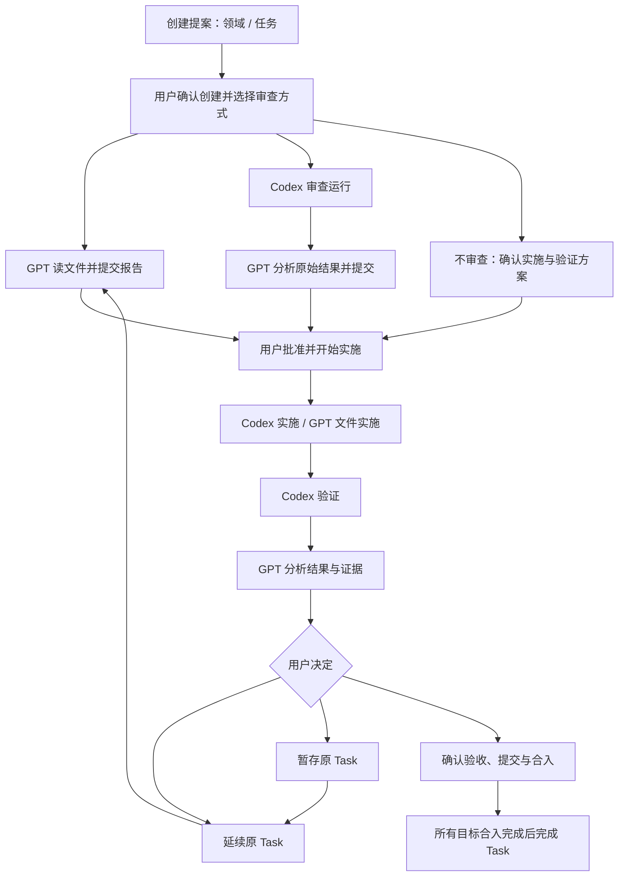

# 全流程审计：Core、GPT 与统一面板

审计日期：2026-10-23，Asia/Shanghai。基线：已部署 `.56` / v28 / schema 131。

后续修复与验证见 [修复记录](workflow-repair-2026-10-23.md)。以下保留 `.56` 审计原始结论。

范围：创建领域/任务、三种审查方式、审查结果、审批与启动、Codex/GPT 文件实施、验证、GPT 分析、延续/暂存/完成合入、异常回读及页面恢复。本次只做源码核对、隔离复现与生产只读检查，没有修复或重启服务，没有提交业务确认、分析或任务操作。

结论：常规成功路径已有实现，主要断点集中在统一面板的失败处理、尚未结束的确认分类，以及 GPT 续接。不能把这些问题都归为 ChatGPT 缓存或连接不稳定。宿主读失败是外部触发因素；本地代码清空列表、销毁组件、遗失关联或缺少续接，也会把短暂故障变成流程阻塞。

## 1. 应当保持的主流程



上图表达产品目标；不审查路径目前仍分为 CONFIRM_IMPLEMENTATION 和 START_APPROVED，见后文设计差异。延续也必须以 Core 返回的准确资格选择重新验证或修订实施，不能一律新建 Review。

| 阶段 | 有效完成依据 | GPT / 面板的职责 |
| --- | --- | --- |
| 创建 | 用户消费准确的创建确认，Core 返回正式对象 | 提案不是 Task；明确显示创建领域还是任务 |
| 审查 | GPT 正式报告入库，或 Codex 结果经 GPT 分析入库 | 清楚区分执行方，沿用准确 Review/Run |
| 审批 | 正式确认被消费，冻结范围、验证规格与运行配置 | 点击“准备”不是批准；获批后不再要求同内容的启动确认 |
| 实施 | 原生运行结果、实际文件变化与 Git 证据 | Codex 正常返回不等于完成工程目标 |
| 验证 | 独立 Codex 验证运行及真实命令/工作区证据 | 不强迫 Codex 生成 JSON；格式化分析由 GPT 负责 |
| 分析 | 准确 sourceHash 与完整逐项报告入库 | 必需 CUSTOM 保留 required；无法实测就报告阻塞/未执行/未知 |
| 验收交付 | 用户明确完成确认，提交与所有冻结目标合入完成 | 完成包含合入；部分交付保留逐仓回执 |
| 异常 | 准确请求/Run 的回执与当前权属 | 结果未知、授权失效、验证未通过和网络读取失败分别展示 |

## 2. 已确认的问题

### F1 · P1：列表读取失败会移除现有确认卡片

触发：面板已有待确认单，后台 dev_bridge_panel_get 一次失败。

代码在 refreshPanelFeed 的 catch 中直接把 panelFeed 设为 null；appendOperationStack 随后得到空列表，并 dispose 原确认组件。结果是 Core 中仍有 PENDING intent，页面却不再显示它，操作数量也消失。读取恢复后组件重新挂载。现有组件保存的部分草稿可能恢复，但组件实例、打开的阅读器等临时状态无法依靠保留 DOM 延续。

依据：[读取失败处理](/Users/phoenix/Documents/devbridge/internal/mcpserver/dev_bridge_ui.html:558)、[组件销毁](/Users/phoenix/Documents/devbridge/internal/mcpserver/dev_bridge_ui.html:1052)。隔离复现 UI-1 确认“原卡片 1 → 0，controller.dispose=true”。上一轮真实面板也出现过相同表现。

建议：保留最后成功列表及组件，明确标记“读取暂不可用”；在新鲜资格不可核对时禁止提交，但不把未知列表当成零条记录，也不显示可重复准备的替代操作。恢复后按准确身份更新。

### F2 · P1：PARTIAL / UNKNOWN 被当成只读历史，安全续接入口被封住

isNextOperation 只接受 PENDING / CONFIRMING，其余都进入历史。历史组件统一 readOnly，连 Core 明确允许的 canResume 原步骤也不能继续。确认组件本身已有“继续本次确认”能力，但外层历史模式提前返回并禁止该请求。

依据：[后续操作分类](/Users/phoenix/Documents/devbridge/internal/mcpserver/dev_bridge_ui.html:1012)、[历史模式禁止续接](/Users/phoenix/Documents/devbridge/internal/mcpserver/confirmation_ui.html:791)、[原步骤续接](/Users/phoenix/Documents/devbridge/internal/mcpserver/confirmation_ui.html:1028)。UI-2 复现 PARTIAL、UNKNOWN 均进入只读历史。

建议：历史仅容纳已结束且不可处理的记录。未决确认单独显示“待核对 / 可续接”，先读原回执；只有 Core 提供 canResume 时才允许继续原请求，不能新建确认或盲目重发未知结果。

### F3 · P1：从当前任务新建任务，刷新后自己的创建提案会被隐藏

当前面板允许通过 composer 明确创建独立任务。该提案能够显示在“后续操作”，依赖仅驻留内存的 panelProposalRequest.requestId。它没有随 widgetState 保存。重新载入后关联丢失，isOtherTaskProposal 把该提案归为其他提案，放入禁止确认的历史；新 Task 尚未创建，也无法通过选择新 Task 找回入口。

依据：[提案关联设置](/Users/phoenix/Documents/devbridge/internal/mcpserver/dev_bridge_ui.html:823)、[恢复状态保存范围](/Users/phoenix/Documents/devbridge/internal/mcpserver/dev_bridge_ui.html:529)、[其他提案判断](/Users/phoenix/Documents/devbridge/internal/mcpserver/dev_bridge_ui.html:1011)。UI-3 复现同一 intent 仅因关联丢失就由可确认变为只读历史。

建议：由 Core 返回同一 Session 中准确的提案来源与用户请求关联，并提供显式提案导航。持久化展示关联不授予业务权限；正式提交仍验证原 intent/version/hash。

### F4 · P1：要求修改方案后，新 GPT 审查没有自动续接

Core 的 REVISE 回执使用 RESOLVE_REVIEW_DECISION 步骤，已经提供 SuccessorReviewID / SuccessorRunID。panelAfterConfirmation 只匹配 START_REVIEW，因此即使新 Review 已创建、授权已准备，也不会自动发起 GPT 的文件审查与正式报告提交。

依据：[Core 后继审查回执](/Users/phoenix/Documents/devbridge/internal/controlapi/confirmation.go:1399)、[仅识别 START_REVIEW](/Users/phoenix/Documents/devbridge/internal/mcpserver/dev_bridge_ui.html:886)。UI-4 复现准确成功回执后没有 ui/message，只有手动“让 GPT 继续审查”仍可用。

建议：按成功回执中的准确后继身份统一识别“需要 GPT 工作”的已授权效果，覆盖创建、普通审查、补审、REVISE 和文件实施；每个效果只交接一次，不依赖单一 step.kind。

### F5 · P1：当前业务成功被历史 backend UNKNOWN 覆盖

对生产同一 Review/Run 只读调用 operation_get，当前返回同时包含：

```text
operation.status = UNKNOWN
operation.recoveryRequired = true
runResults[0].status = SUCCEEDED
workflow.state = REVIEW_APPROVAL_PENDING
workflow.blockers = []
```

这不是不同任务或旧页面缓存，而是同一次新响应中的字段冲突。通用 agentexecution reducer 在最后用 UNKNOWN 后端观测覆盖成功运行的当前摘要，MCP operation_get 又直接采用该投影。GPT 容易据此要求恢复已经完成的审查。

依据：[UNKNOWN 覆盖](/Users/phoenix/Documents/devbridge/internal/agentexecution/projection.go:174)、[operation_get 投影选择](/Users/phoenix/Documents/devbridge/internal/mcpserver/surface_reads.go:1167)。真实响应摘录保存在 build/flow-audit-20261023/live-status-conflict.json。

建议：保留历史 UNKNOWN 证据，但把历史运行不确定性、当前文件授权和当前需要用户处理的 recovery 拆开。对已入库的 GPT Review，由当前业务状态决定下一步；不能因历史 backend 字段重新要求恢复。

### F6 · P2：交给 GPT 的请求缺少可持续跟踪的业务回执

sendConversationContext 把宿主接收消息当成发送完成；conversationAttempts 随后持续禁用同一步按钮，没有关联 prepare/report 的成功或明确失败。GPT 若返回准备拒绝，面板仍显示“已请求”，只能回对话处理或重新加载。

另外，授权/正式确认成功后，panelAfterConfirmation 只做一次 fresh read；该读取失败就返回。随后普通轮询恢复也不会补发已获授权的 GPT 交接。UI-5 已复现此断点。

依据：[仅跟踪消息发送](/Users/phoenix/Documents/devbridge/internal/mcpserver/dev_bridge_ui.html:694)、[成功后单次回读](/Users/phoenix/Documents/devbridge/internal/mcpserver/dev_bridge_ui.html:896)、[内存中的交接去重](/Users/phoenix/Documents/devbridge/internal/mcpserver/dev_bridge_ui.html:786)。

建议：区分“用户请求、确认已入库、等待交接、GPT 已接收、结果已提交、明确拒绝、结果未知”。持久化准确用户请求及业务目标；短暂只读失败恢复后可继续尚未发送的同一授权交接，宿主发送结果未知时仍禁止自动重复消息。明确准备拒绝后给出面板内修正/同请求回读路径，而不是永久禁用或要求复制指令。

### F7 · P2：APPROVAL_READY 不保证方案能通过准备门禁

.56 修正了 required CUSTOM，但更一般的校验时点差异仍在：ReviewReport.Validate 调用 ValidateVerificationSpec，execution_prepare 才调用 ValidateExecutableVerificationSpec。

隔离 Go 探针构造 required TEST_COMMAND + instruction（没有 command）：报告被接受为 APPROVAL_READY，随后执行准备返回 UNOBSERVABLE_REQUIRED_CHECK。类型与内容都没有在两步之间变化，用户却在批准时才发现方案不能执行。

依据：[审查报告校验](/Users/phoenix/Documents/devbridge/internal/review/report.go:176)、[执行准入](/Users/phoenix/Documents/devbridge/internal/task/spec.go:295)。探针结果：build/flow-audit-20261023/admission-probe.json。

建议：保留报告本身的不可变证据，但在发布“可审批”资格前统一运行所有无需副作用的方案准入校验，并返回逐项缺陷。无需因此新增审查轮次或重新运行 Codex。不要通过降低 required 来消除不一致。

### F8 · P2：对外仍存在两种不同的“完成任务”合同

新 COMPLETE_TASK 冻结 CompletionPlan，并在任务提交后调用 FinishTaskCompletion 完成合入。旧 ACCEPT 仍被 pendingDecision 的描述称为“complete the Task”，但无 CompletionPlan 时不会调用该合入路径；旧验收兼容行为还允许完整的失败事实经用户明确接受。

依据：[旧 ACCEPT 对外含义](/Users/phoenix/Documents/devbridge/internal/mcpserver/external_projection.go:992)、[只有 CompletionPlan 才合入](/Users/phoenix/Documents/devbridge/internal/storage/sqlite/task_acceptance_store.go:40)、[完成准备的计划冻结](/Users/phoenix/Documents/devbridge/internal/controlapi/task_verification_decisions.go:69)。

建议：新任务对外只给 CONTINUE_TASK / COMPLETE_TASK / DEFER_TASK；兼容 ACCEPT 明确标为“仅旧版验收”，不能继续描述成当前主流程的完成。不要自动把历史 ACCEPT 回执改成已合入。

## 3. 设计与边界风险

1. **不审查路径仍有额外正式启动确认。** CONFIRM_IMPLEMENTATION 只冻结定义，之后仍要 START_APPROVED；这与审查路径“批准并开始实施”的交互不同。两次确认现在是显式合同而非重复执行 bug，但不符合尽量一次完成方案批准和运行配置选择的产品目标。可以统一为准确、完整的“确认方案并开始”，保留实际授权。
2. **轮询没有失败退避。** 状态与确认列表各自以 5 秒周期读取；确认组件挂载又读取自身信息/选项。失败仍按原周期继续。不能据此断言 Cloudflare 由本项目触发，但已有间歇失败时，缺少退避和统一读取协调会增加故障面。
3. **Session 列表上限 20。** 服务优先排待处理但按整个 Session 截断，随后前端才按当前任务筛选。若有大量其他任务/创建提案待处理，当前任务的老确认可能落在截断范围外；“后续操作”没有完整性提示。该边界未在生产中触发。见 internal/storage/sqlite/session_confirmation_feed.go:19、internal/controlapi/panel_confirmation_feed.go:53。
4. **文档存在相互覆盖的历史合同。** task-execution-v0.1.md 开头仍有 v46/v76/G0 的“多仓 Coding 不支持”“文件实施 RUN 验证不支持”和独立启动要求；这些不能再作为 v131/.56 的当前说明。历史验收材料应保留，但应有单一当前合同入口和清晰适用版本。

## 4. 已经具备、应保留的约束

- 准确 Session/Task/Review/Run/定义版本、不可变 intent hash、幂等回执和正式用户确认不能为减少对话而绕过。
- Codex 原生运行成功、GPT 工程判断、用户验收和 Git 合入是不同事实。新 NATURAL_V1 路径不发送最终回复 outputSchema；历史已派发 Run 保留原协议。
- APPROVE_AND_START 的 Coding 路径已记录 START_AUTHORIZED，并有写侧续接队列；本次没有发现其正常成功路径还必须让用户第二次确认启动。
- 验证读写隔离、真实命令及仓库来源、GPT 不能覆盖 Core 观测事实，以及 CUSTOM 未执行/受阻不能完成并合入，这些约束应继续保持。
- 已完成历史不能重新确认，但这不能扩大成所有非 PENDING 项都永远不可续接。

## 5. 建议实施顺序与验收

第一批：F1、F2、F3，先保证待办不会因读取失败、刷新或未决状态而消失；测试必须覆盖同一已打开正式组件、选择/阅读状态和安全提交资格，而非只匹配按钮文案。

第二批：F4、F6，统一准确授权效果到 GPT 工作的交接和回执，覆盖 REVISE、补审、恢复、普通创建与文件实施；注入“业务成功后回读失败”“模型收到请求但准备被拒”“发送回执丢失”，确保不会丢交接或重复执行。

第三批：F5、F7、F8，统一各客户端当前状态及动作含义，校验提前，主流程完成统一包含合入；保留历史 UNKNOWN 和旧协议的可审计读取。

随后再收敛文案、文档和轮询，避免继续用资源版本递增、重发会话消息来替代流程一致性修复。

生产完整验收必须从当前原 Task 继续，分别核对正式用户批准、真正启动的实施 Run、实际 diff、独立验证、GPT 分析提交、延续/暂存、完成与逐仓合入；不能把 fake App Server 隔离测试当成 Skeleton 的真实模型验收。

## 6. 证据与本次限制

隔离 UI 复现 5 项全部复现当前问题，**不是修复后回归通过**。脚本与结果：build/flow-audit-20261023/ui-audit.test.cjs、ui-reproductions.log。Go 探针：admission-probe/main.go、admission-probe.json。真实只读状态冲突：live-status-conflict.json。

最终只读核对：原 Task 仍 ACTIVE / REVIEW_APPROVAL_PENDING，原待确认单 confirm_3961936892650b1e33020a31ce7ef03e 为 PENDING / APPROVE_AND_START，没有活动 Run；详见 current-state.json。已部署 .56 清单内生产源码哈希未变化。本次只新增审计报告与隔离探针材料；没有替用户批准、启动、恢复、创建/关闭任务或给原 GPT 会话发消息。
